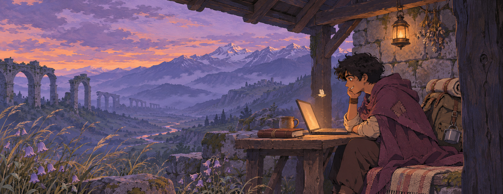

<picture>
  <source media="(prefers-reduced-motion: no-preference)" srcset="./assets/waystation.png">
  
</picture>

```text
boon@camp:~$ cat access.log
[WARN] moth bypassed lantern authentication.
```

### hey, i'm boon.

offensive security is my favourite rabbit hole.

security+ certified · msc cybersecurity student · always curious.

[linkedin](https://www.linkedin.com/in/boon-suni/)
